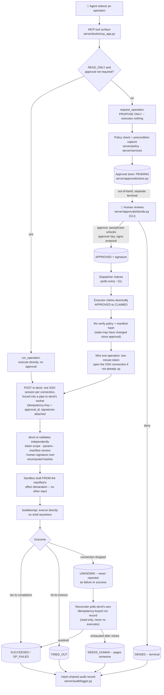
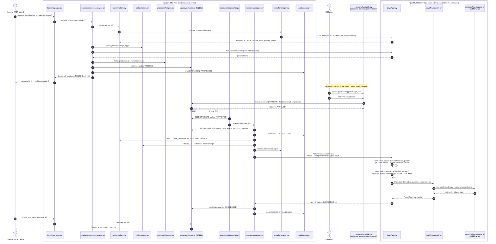

# Architecture

Two diagrams. The first is the conceptual request lifecycle (what happens,
in order, regardless of which file does it). The second is the literal file
map: which module calls which, across the three process boundaries this
system actually has (the MCP server process, the human's CLI process, and
`devd` inside the container, reached only over the SSH tunnel).

Both reflect what's actually implemented and tested here, not the doc's
full production design — see [ROADMAP.md](./ROADMAP.md) for what's done vs.
outstanding, and the README's "What's simulated" section for the local-demo
substitutions (software CA, `--privileged` container, etc.).

## 1. Overview: the request lifecycle

Two independent enforcement points make this hold even if the control plane
is compromised: **devd never trusts what the server asserts** — it re-loads
its own manifest from local disk, re-validates every param, and checks that
the per-request token actually names the operation being called.

## 2. File map: who calls whom, and when

Real module names, real call order, across the three process boundaries.
"Control plane" and "Data plane" run continuously; "Human / CLI" is a
separate process invoked on demand, writing to the same SQLite file.

**If the tunnel drops mid-call** (not shown above to keep the happy path
readable): `executor.py` catches the transport error, sets the approval to
`UNKNOWN`, and enqueues it with `execution/reconciler.py`, which polls
`GET /runs/by-idempotency-key/{approval_id}` on `devd/app.py` — read-only,
never re-executing — until it resolves or exhausts its retries into
`NEEDS_HUMAN`. Covered for real in
`tests/integration/test_end_to_end.py::TestFaultInjection`.

**`run_operation`** (the direct, no-approval path for `READ_ONLY`
operations) is the same diagram with the top half skipped: `Tools` →
`Svc.run_operation` → straight to `App` over the tunnel, no `Store` row
created at all.
